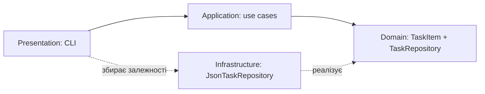

# Lab 5 — менеджер завдань

Консольний застосунок для створення, перегляду та завершення завдань. Дані зберігаються у JSON-файлі. Проєкт показує Clean Architecture та напрямок залежностей від зовнішніх шарів до внутрішніх.

## Шари



`Domain` містить модель `TaskItem` та контракт `TaskRepository`. Use cases у `Application` залежать від контракту. `Infrastructure` реалізує контракт через `data/tasks.json`, а `Presentation` створює адаптер і передає його use cases через конструктор.

## Структура

```text
lib/
├── domain/entities/task_item.dart
├── domain/repositories/task_repository.dart
├── application/use_cases/{create_task,list_tasks,complete_task}.dart
├── infrastructure/repositories/json_task_repository.dart
└── presentation/cli/task_cli.dart
bin/lab5_clean_architecture.dart
```

## Запуск

Потрібен Dart SDK 3.3 або новіший. Проєкт не має сторонніх пакетів.

```sh
dart pub get
dart run bin/lab5_clean_architecture.dart list
dart run bin/lab5_clean_architecture.dart add "Підготувати звіт"
dart run bin/lab5_clean_architecture.dart list
dart run bin/lab5_clean_architecture.dart done ID
```

Команда `done` приймає ID, який показує `list`. Файл даних створюється автоматично й не додається до Git.

## Git-процес

Модель гілок: `main` — стабільна версія, `develop` — інтеграція, `feature/*` — окрема робота над шаром. У цій навчальній копії кроки гілок, комітів, злиттів, перегляду коду, конфлікту та тегу відтворені локально. Віддалений сервер не налаштований, тому локальні PR-описи та зауваження збережені в `docs/pull-requests/`; це не опубліковані GitHub/GitLab PR.

Щоб повторити локальний перегляд історії:

```sh
git log --oneline --graph --decorate --all
git branch -a
git show v1.0.0
```

Коментарі рев'ю та відповіді з виправленнями наведені у PR-описах. В окремому злитті було змінено один рядок у `app.config` в інфраструктурній гілці та в `develop`; конфлікт вирішено на користь `data/tasks.json` і зафіксовано окремим merge-комітом.
