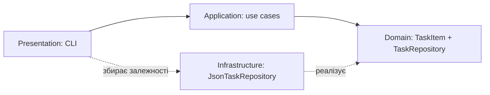

# Lab 5 — менеджер завдань

Консольний застосунок для створення, перегляду та завершення завдань. Дані зберігаються у JSON-файлі. Проєкт показує Clean Architecture та напрямок залежностей від зовнішніх шарів до внутрішніх.

## Шари



`Domain` містить модель `TaskItem` та контракт `TaskRepository`. Use cases у `Application` залежать від контракту. `Infrastructure` реалізує контракт через `data/tasks.json`, а `Presentation` створює адаптер і передає його use cases через конструктор.

## Структура

```text
lib/
├── domain/entities/task_item.dart
├── domain/repositories/task_repository.dart
├── application/use_cases/{create_task,list_tasks,complete_task}.dart
├── infrastructure/repositories/json_task_repository.dart
└── presentation/cli/task_cli.dart
bin/lab5_clean_architecture.dart
```

## Запуск

Потрібен Dart SDK 3.3 або новіший. Проєкт не має сторонніх пакетів.

```sh
dart pub get
dart run bin/lab5_clean_architecture.dart list
dart run bin/lab5_clean_architecture.dart add "Підготувати звіт"
dart run bin/lab5_clean_architecture.dart list
dart run bin/lab5_clean_architecture.dart done ID
```

Команда `done` приймає ID, який показує `list`. Файл даних створюється автоматично й не додається до Git.

## Git-процес

Віддалений репозиторій: https://github.com/ki27klimovmaksym-byte/lab5-clean-architecture. У ньому є гілки `main`, `develop`, чотири початкові `feature/*` та тег `v1.0.0`. Початкові feature-гілки було злито перед публікацією, тому їхній PR-процес описано в локальних картках `docs/pull-requests/`.

Після основної інтеграції для реального показу PR-рев’ю створено окремі додаткові PR-и. Вони були відкриті до злиття в `develop`, отримали коментар рев’ю та окремий виправлювальний коміт:

- [PR #1 — інваріанти сутності TaskItem](https://github.com/ki27klimovmaksym-byte/lab5-clean-architecture/pull/1)
- [PR #2 — незмінення результату репозиторію в CompleteTask](https://github.com/ki27klimovmaksym-byte/lab5-clean-architecture/pull/2)
- [PR #3 — перевірка структури JSON у сховищі](https://github.com/ki27klimovmaksym-byte/lab5-clean-architecture/pull/3)
- [PR #4 — перевірка ID у CLI](https://github.com/ki27klimovmaksym-byte/lab5-clean-architecture/pull/4)
- [PR #5 — злиття reviewed follow-ups у main](https://github.com/ki27klimovmaksym-byte/lab5-clean-architecture/pull/5)

Щоб переглянути історію:

```sh
git log --oneline --graph --decorate --all
git branch -a
git show v1.0.0
```

Конфлікт злиття змодельовано в `app.config`: у двох гілках змінювався `storage.path`. Конфлікт вирішено на користь шляху `data/tasks.json` і зафіксовано окремим merge-комітом.
